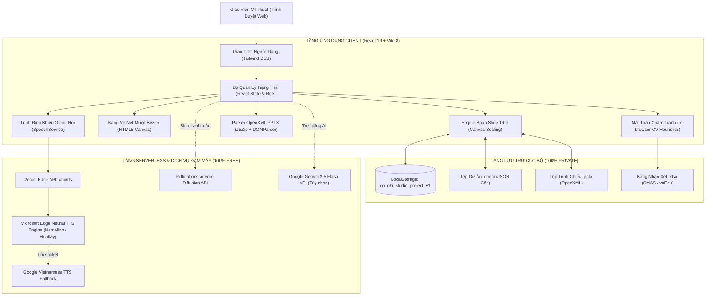

# TÀI LIỆU KỸ THUẬT: CỌ NHÍ STUDIO
### BÁO CÁO KIẾN TRÚC HỆ THỐNG & ĐẶC TẢ KỸ THUẬT CHI TIẾT (SYSTEM SPECIFICATION)

---

## 1. TỔNG QUAN KIẾN TRÚC CÔNG NGHỆ (TECH STACK)

Cọ Nhí Studio được xây dựng dựa trên kiến trúc **Single Page Application (SPA) tiến bộ**, kết hợp mô hình **Serverless Edge Functions** nhằm đảm bảo tính năng hoạt động độc lập ngoại tuyến (offline-first) nhưng vẫn mở rộng linh hoạt trên hạ tầng đám mây không mất phí.



---

## 2. DANH MỤC THƯ VIỆN & CÔNG NGHỆ CỐT LÕI

| Thành phần | Công nghệ / Thư viện | Phiên bản | Mục đích kỹ thuật |
| :--- | :--- | :--- | :--- |
| **Core Framework** | React.js | 19.3.1 | Xây dựng cây component giao diện với hiệu năng render tối ưu |
| **Build Tool** | Vite | 8.3.5 | Trình đóng gói siêu tốc, hỗ trợ HMR và biên dịch ES Module chuẩn |
| **Styling** | Tailwind CSS | 3.4.17 | Thiết kế giao diện utility-first responsive cho mọi độ phân giải |
| **Icons** | Lucide React | 1.66.0 | Hệ thống biểu tượng vector đồ họa chuẩn mực, sắc nét |
| **PPTX Decompressor** | JSZip | 3.10.2 | Giải nén gói OpenXML `.pptx` trực tiếp trong RAM trình duyệt |
| **XML Parser** | @xmldom/xmldom | 0.9.12 | Phân tích cú pháp cây XML của `slide.xml`, `presentation.xml` |
| **PPTX Generator** | pptxgenjs | 4.0.1 | Tạo và đóng gói tệp PowerPoint `.pptx` từ các đối tượng canvas |
| **Spreadsheet Engine**| xlsx (SheetJS) | 0.18.5 | Đọc danh sách học sinh và xuất bảng điểm nhận xét chuẩn SMAS |
| **Neural TTS Engine** | msedge-tts | 2.1.1 | Kết nối WebSocket tới máy chủ Microsoft Speech tạo giọng nam/nữ |
| **Micro-Animations** | canvas-confetti | 1.9.4 | Hiệu ứng pháo hoa khích lệ học sinh khi hoàn thành bài vẽ |

---

## 3. CẤU TRÚC THƯ MỤC DỰ ÁN (PROJECT REPOSITORY LAYOUT)

```
co-nhi-studio/
├── api/
│   └── tts.js                     # Vercel Serverless Function tổng hợp giọng đọc Neural
├── public/
│   ├── favicon.svg                # Biểu tượng tab trình duyệt
│   └── icons.svg                  # Biểu tượng vector mĩ thuật
├── src/
│   ├── assets/                    # Hình ảnh tĩnh và tài nguyên đồ họa
│   ├── components/
│   │   ├── Header.jsx             # Thanh tiêu đề, tệp dự án, xuất/nhập PPTX, lưu trữ
│   │   ├── ArtCamera/
│   │   │   └── ArtCameraRubric.jsx# Mắt thần chấm tranh theo Rubric Thông tư 27
│   │   ├── ArtGames/
│   │   │   ├── ArtGames.jsx       # Bảng điều khiển 3 mini-game giáo dục mĩ thuật
│   │   │   └── SlideGameWidget.jsx# Widget trò chơi nhúng trực tiếp trong trang slide
│   │   ├── Assistant/
│   │   │   └── OfflinePedagogyAssistant.jsx # Khung trợ giảng AI đa mô hình
│   │   ├── DrawingBoard/
│   │   │   └── DrawingBoard.jsx   # Bảng vẽ thị phạm nét mượt 11 hình khối 3D
│   │   ├── Evaluation/
│   │   │   └── StudentEvaluationSMAS.jsx   # Quản lý nhận xét và xuất Excel SMAS
│   │   ├── Media/
│   │   │   └── MediaYouTubeModal.jsx       # Hộp thoại chèn âm thanh, video, YouTube
│   │   ├── SlideEditor/
│   │   │   ├── PPTXPreviewModal.jsx        # Hộp thoại xem trước slide PowerPoint
│   │   │   ├── PresentationModal.jsx       # Chế độ trình chiếu toàn màn hình (F5)
│   │   │   ├── SlideCanvas.jsx             # Khung canvas 16:9 tương tác phần tử
│   │   │   ├── SlideEditorView.jsx         # Khung làm việc chính của trình soạn slide
│   │   │   ├── SlideThumbnailList.jsx      # Danh sách slide thu nhỏ bên trái
│   │   │   ├── SpeakerNotes.jsx            # Bảng soạn lời giảng và phát âm thanh
│   │   │   └── Toolbar.jsx                 # Thanh công cụ định dạng chữ/hình/ảnh
│   │   └── IdeaWorkshop/
│   │       └── IdeaWorkshop.jsx   # Xưởng ý tưởng bài dạy mĩ thuật GDPT 2018
│   ├── data/
│   │   ├── artGamesCurriculumBank.js # Ngân hàng câu hỏi trò chơi theo khối lớp 1-5
│   │   ├── pedagogyBank.js        # Ngân hàng chủ đề, mục tiêu sách Kết nối tri thức
│   │   └── slideTemplates.js      # Các bố cục mẫu gợi ý cho trang slide
│   ├── utils/
│   │   ├── pptxExportService.js   # Module xuất dữ liệu sang tệp PowerPoint .pptx
│   │   ├── pptxImportService.js   # Module đọc và phân tích tệp PowerPoint OpenXML
│   │   ├── speechService.js       # Module điều phối phát âm thanh tiếng Việt
│   │   └── storageService.js      # Module lưu trữ LocalStorage & tệp .conhi
│   ├── App.jsx                    # Điểm khởi nhập chính và điều phối các Tab
│   ├── main.jsx                   # Mount React vào phần tử DOM index.html
│   └── index.css                  # Cấu hình Tailwind CSS và biến phong cách
├── index.html                     # Trang gốc HTML5
├── package.json                   # Khai báo phụ thuộc và kịch bản thực thi
├── tailwind.config.js             # Cấu hình bảng màu và font chữ Tailwind
├── vercel.json                    # Cấu hình định tuyến và triển khai Vercel
└── vite.config.js                 # Cấu hình Vite dev server & middleware TTS
```

---

## 4. ĐẶC TẢ SCHEMA DỮ LIỆU CỐT LÕI (DATA SCHEMAS)

### 4.1. Cấu trúc Dự Án Bài Giảng (Project Schema)
```typescript
interface CoNhiProject {
  title: string;           // Tên bài giảng mĩ thuật (ví dụ: "Bài 1: Sắc Màu Thiên Nhiên")
  updatedAt: string;       // Thời gian lưu gần nhất theo chuẩn ISO 8601
  version: "1.0.0";        // Phiên bản cấu trúc dữ liệu
  slides: SlideObject[];   // Danh sách các trang slide
}
```

### 4.2. Cấu trúc Trang Slide (Slide Object)
```typescript
interface SlideObject {
  id: string;              // Khóa định danh duy nhất (ví dụ: "slide-1793718000")
  title: string;           // Tiêu đề của trang slide (ví dụ: "Trang 1: Khởi động")
  background: string;      // Màu nền hex (#ffffff, #fffbeb, #1e293b,...)
  notes: string;           // Ghi chú lời giảng sư phạm của Thầy/Cô
  elements: SlideElement[];// Mảng chứa các phần tử đồ họa trên slide
}
```

### 4.3. Cấu trúc Các Phần Tử Slide (Slide Element Types)
Các phần tử kế thừa từ một cấu trúc hình học cơ bản (bounding box 2D logic 960 x 540):
```typescript
interface BaseElement {
  id: string;              // ID phần tử (ví dụ: "el-123456")
  type: 'text' | 'shape' | 'image' | 'audio' | 'video' | 'youtube' | 'game';
  x: number;               // Tọa độ X (pixels, tính từ góc trái trên)
  y: number;               // Tọa độ Y (pixels)
  width: number;           // Chiều rộng (pixels)
  height: number;          // Chiều cao (pixels)
}

// 1. Phần tử Văn Bản (Text)
interface TextElement extends BaseElement {
  type: 'text';
  text: string;
  fontSize: number;        // Kích thước chữ (px)
  fontWeight: 'normal' | 'bold';
  fontStyle: 'normal' | 'italic';
  color: string;           // Màu chữ hex (ví dụ: "#1e293b")
  textAlign: 'left' | 'center' | 'right';
}

// 2. Phần tử Hình Khối (Shape)
interface ShapeElement extends BaseElement {
  type: 'shape';
  shapeType: 'rect' | 'circle' | 'triangle' | 'star' | 'arrow' | 'roundedRect';
  fill: string;            // Màu tô hình (hex)
  stroke: string;          // Màu viền (hex)
  strokeWidth: number;     // Độ dày viền
  opacity: number;         // Độ trong suốt (0.0 đến 1.0)
}

// 3. Phần tử Hình Ảnh (Image)
interface ImageElement extends BaseElement {
  type: 'image';
  src: string;             // Đường dẫn URL ảnh (Blob URL, Data URL base64 hoặc URL mạng)
  isBackground?: boolean;  // Có đặt làm hình nền toàn trang slide hay không
}

// 4. Phần tử Trò Chơi Mĩ Thuật Nhúng (Mini-game)
interface GameElement extends BaseElement {
  type: 'game';
  gameType: 'color' | 'shape' | 'detail';
  title: string;
  grade: number;           // Khối lớp (1 đến 5)
  question: string;
  options: string[];
  correctAnswer: string;
}
```

---

## 5. GIẢI PHÁP KỸ THUẬT ĐẶC TRƯNG & THUẬT TOÁN ĐỘT PHÁ

### 5.1. Thuật toán làm mượt nét vẽ bằng đường cong Bézier bậc 2 (Quadratic Bézier Spline)
Khi người dùng vẽ bằng chuột trên máy tính, sự kiện `mousemove` truyền về các tọa độ rời rạc. Nếu chỉ nối bằng đường thẳng `lineTo`, nét vẽ sẽ bị gãy khúc.
Cọ Nhí Studio triển khai thuật toán đệm điểm và làm mượt thời gian thực:
```javascript
// Khi người dùng di chuột, lưu tọa độ vào bộ đệm pointsRef
pointsRef.current.push(coords);

if (pointsRef.current.length >= 3) {
  const len = pointsRef.current.length;
  const p0 = pointsRef.current[len - 3];
  const p1 = pointsRef.current[len - 2];
  const p2 = pointsRef.current[len - 1];

  // Tính trung điểm của các đoạn thẳng kế tiếp làm điểm neo đường cong
  const midPrev = { x: (p0.x + p1.x) / 2, y: (p0.y + p1.y) / 2 };
  const midNext = { x: (p1.x + p2.x) / 2, y: (p1.y + p2.y) / 2 };

  ctx.beginPath();
  ctx.moveTo(midPrev.x, midPrev.y);
  // Vẽ đường cong mềm mại qua điểm điều khiển p1
  ctx.quadraticCurveTo(p1.x, p1.y, midNext.x, midNext.y);
  ctx.stroke();
}
```

### 5.2. Hàng Đợi (Queue) & Thử Lại (Retry) Cho Dịch Vụ Giọng Đọc Neural TTS
Máy chủ Microsoft Edge TTS giới hạn các kết nối song song từ cùng một địa chỉ IP client. Nếu gửi nhiều yêu cầu âm thanh đồng thời, kết nối WebSocket sẽ bị đóng trước tín hiệu `turn.end`.
Để khắc phục triệt để, hệ thống triển khai cơ chế tuần tự hóa Promise kết hợp 3 lượt thử lại tự động:
```javascript
let ttsQueue = Promise.resolve();

async function synthesizeEdgeTtsWithRetry(cleanText, voiceName) {
  return new Promise((resolve, reject) => {
    // Xếp hàng các yêu cầu để tránh xung đột socket
    ttsQueue = ttsQueue.then(async () => {
      for (let attempt = 1; attempt <= 3; attempt++) {
        try {
          const tts = new MsEdgeTTS();
          await tts.setMetadata(voiceName, OUTPUT_FORMAT.AUDIO_24KHZ_48KBITRATE_MONO_MP3);
          const { audioStream } = tts.toStream(cleanText);
          const chunks = [];

          await new Promise((res, rej) => {
            audioStream.on('data', c => chunks.push(c));
            audioStream.on('end', () => res());
            audioStream.on('error', err => {
              // Nếu đã nhận được dữ liệu âm thanh, vẫn sử dụng
              if (chunks.length > 0) res();
              else rej(err);
            });
          });

          const audioBuf = Buffer.concat(chunks);
          if (audioBuf.length > 0) {
            resolve(audioBuf);
            return;
          }
        } catch (err) {
          if (attempt === 3) {
            reject(err);
            return;
          }
          await new Promise(r => setTimeout(r, 350));
        }
      }
    }).catch(reject);
  });
}
```

### 5.3. Bảo Mật Dữ Liệu Học Sinh (Privacy-Preserving Vision Heuristics)
Để tuân thủ nghiêm ngặt quy định bảo vệ trẻ em trên môi trường mạng:
* Toàn bộ quá trình đánh giá tranh của học sinh trong chức năng **Cam Chấm Tranh** được tính toán trực tiếp trên phần cứng máy khách bằng Canvas API 2D.
* Hàm `getImageData` tính toán ma trận độ sáng trung bình (Brightness Distribution), tỷ lệ sắc màu nóng/lạnh (Warm/Cool Pixel Ratio) để nhận diện bố cục và hòa sắc bài vẽ mà không gửi dù chỉ 1 byte ảnh của trẻ lên mạng.

---

## 6. QUY TRÌNH BIÊN DỊCH & TRIỂN KHAI TỰ ĐỘNG (CI/CD PIPELINE)

Hệ thống được thiết lập tự động hóa hoàn toàn với Vercel và GitHub:
1. **Lập trình viên / AI Agent:** Thực hiện thay đổi mã nguồn trong thư mục dự án và thực hiện `git push origin main`.
2. **GitHub Webhook:** Nhận diện commit mới và tự động gửi thông báo (trigger) sang Vercel.
3. **Vercel Build Server:**
   * Chạy lệnh `npm install` khôi phục cây phụ thuộc.
   * Thực thi `npm run build` (`vite build`) tạo thư mục xuất bản tĩnh `dist/`.
   * Đóng gói endpoint Serverless `api/tts.js` triển khai trên mạng lưới Vercel Edge.
   * Gán bí danh miền cố định: **`https://co-nhi-studio.vercel.app`**.
   * Thời gian hoàn tất chu trình: **dưới 35 giây**.
