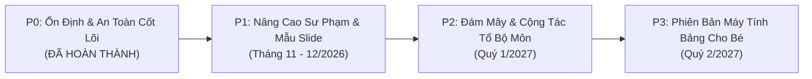

# ĐỊNH HƯỚNG SẢN PHẨM, CHIẾN LƯỢC PHÂN TẦNG FREE/PRO/VIP & LỘ TRÌNH PHÁT TRIỂN (CỌ NHÍ STUDIO)

**Phiên bản:** GDPT 2018 — Hệ thống Soạn Giảng & Trợ Giảng Mĩ Thuật Tiểu Học  
**Ngày ban hành:** 07/11/2026  
**Chủ trì kỹ thuật:** Kỹ sư trưởng hệ thống  

---

## 1. Tôn Chỉ Sản Phẩm & Lợi Thế Cạnh Tranh Khác Biệt

Cọ Nhí Studio được định vị là **nền tảng chuyên biệt dành cho giáo viên Mĩ thuật tiểu học Việt Nam**, bám sát chương trình Giáo dục Phổ thông 2018 (Thông tư 32/2018/TT-BGDĐT) và quy định đánh giá học sinh tiểu học (Thông tư 27/2020/TT-BGDĐT).

### Bảng So Sánh Đối Chiếu Với Các Nền Tảng Phổ Biến

| Tiêu chí | Cọ Nhí Studio | Canva Education | ClassPoint | PowerPoint Copilot |
| :--- | :--- | :--- | :--- | :--- |
| **Định hướng cốt lõi** | Chuyên biệt Mĩ thuật tiểu học VN | Thiết kế đồ họa đa dụng | Tương tác bài giảng chung | Văn phòng doanh nghiệp |
| **Bám sát GDPT 2018** | **100% Khung chuẩn Lớp 1-5** | Không có khung sư phạm VN | Không có khung sư phạm VN | Không có |
| **Đánh giá & Nhận xét** | **Rubric TT27, xuất SMAS** | Không hỗ trợ | Quiz trắc nghiệm chung | Không hỗ trợ |
| **Thị phạm vẽ trực tiếp** | **Bảng vẽ Canvas chuyên dụng** | Vẽ tự do cơ bản | Vẽ chú thích slide | Bút vẽ inking cơ bản |
| **Hoạt động ngoại tuyến** | **Có (Offline core features)** | Phụ thuộc 100% Internet | Cần mạng khi dạy học | Cần bản quyền Office 365 |
| **Xuất tệp bài giảng** | **Chuẩn PPTX + Tệp `.conhi`** | Xuất PDF / PPTX tĩnh | Không xuất được bài giảng | Định dạng PPTX |
| **Chi phí triển khai** | **100% Miễn phí cốt lõi** | Cần xác minh trường học | Trả phí thuê bao tháng | Rất đắt ($30/người dùng/tháng) |

---

## 2. Mô Hình Phân Tầng Tính Năng (Free / Pro / VIP)

> [!IMPORTANT]
> **NGUYÊN TẮC BẮT BUỘC:** Tuyệt đối không bao giờ khóa các tính năng sư phạm cơ bản để ép giáo viên nâng cấp. Giáo viên ở vùng sâu, vùng xa hoặc trường công lập luôn có thể sử dụng trọn vẹn app miễn phí vĩnh viễn.

```mermaid
graph TD
    A["Cọ Nhí Studio Platform"] --> B["BẢN MIỄN PHÍ (Free Forever)"]
    A --> C["PRO CÁ NHÂN (Individual Pro)"]
    A --> D["VIP / TRƯỜNG HỌC (School Enterprise)"]

    B --> B1["Soạn slide, trình chiếu F5"]
    B --> B2["Bảng vẽ thị phạm HTML5"]
    B --> B3["Ngân hàng bài dạy GDPT 2018 cục bộ"]
    B --> B4["Lưu LocalStorage & Tệp .conhi"]
    B --> B5["Chấm tranh Rubric TT27 thủ công"]

    C --> C1["Xưởng Ý Tưởng AI (Câu lệnh tự nhiên)"]
    C --> C2["Tạo Trò Chơi Mĩ Thuật bằng AI"]
    C --> C3["Tạo tranh mẫu minh họa AI đa chất liệu"]
    C --> C4["Giọng đọc Microsoft Edge Neural TTS"]
    C --> C5["Xuất PPTX nâng cao"]

    D --> D1["Quản trị phân quyền tổ/khối chuyên môn"]
    D --> D2["Thư viện bài giảng dùng chung trường học"]
    D --> D3["Đồng bộ & Sao lưu đám mây an toàn"]
    D --> D4["Hạn mức AI ưu tiên cao"]
```



### Chi Tiết Cấp Quyền Từng Phân Tầng

#### 1. Bản Miễn Phí (Free Forever — Dành cho mọi giáo viên)
- Soạn thảo bài giảng mĩ thuật không giới hạn số lượng trang.
- Bảng vẽ thị phạm đầy đủ cọ vẽ, bảng màu, tẩy, chèn tranh vào slide.
- Trò chơi Mĩ thuật cục bộ (Ghép màu, Đoán hình khối, Tìm chi tiết tranh dân gian).
- Xưởng Ý tưởng cục bộ theo 5 khối lớp SGK Kết nối tri thức.
- Lưu trữ 100% cục bộ trên máy, xuất và nhập tệp bài giảng định dạng `.conhi`.
- Camera chấm tranh và bảng chấm điểm học sinh xuất ra tệp Excel chuẩn SMAS.

#### 2. Bản Pro Cá Nhân (Dành cho giáo viên muốn ứng dụng AI chuyên sâu)
- **Xưởng Ý Tưởng AI:** Hiểu câu lệnh tự nhiên, tự động thiết kế tiến trình 4 hoạt động, câu hỏi gợi mở, lời giảng và rubric bám sát chất liệu, thời lượng và đối tượng học sinh.
- **Trò Chơi AI:** Tạo câu hỏi trắc nghiệm, thử thách thẩm mĩ bằng câu lệnh tự do.
- **Họa sĩ ảo AI:** Tạo tranh mẫu tham khảo theo 5 phong cách chất liệu (sáp màu, màu nước, xé dán, đất nặn, tái chế).
- **Giọng đọc Thầy giáo / Cô giáo:** Microsoft Edge Neural TTS tiếng Việt tự nhiên phát trực tiếp trong bài giảng.
- **Xuất PPTX nâng cao:** Xuất đầy đủ ghi chú diễn giả, bảng màu và hình khối.

#### 3. Bản VIP / Trường Học (Dành cho Tổ chuyên môn & Ban giám hiệu)
- **Đa tài khoản & Phân quyền:** Quản trị viên cấp quyền theo Gmail, phân chia tổ trưởng, giáo viên bộ môn.
- **Thư viện bài giảng dùng chung:** Giáo viên trong trường chia sẻ slide, kế hoạch bài dạy và bộ câu hỏi cho nhau.
- **Sao lưu đám mây tự động:** Chống mất mát dữ liệu khi giáo viên đổi máy tính hoặc cài lại Windows.
- **Hạn mức AI ưu tiên:** Đảm bảo tốc độ phản hồi nhanh trong các đợt hội giảng, thao giảng cấp cụm/quận/tỉnh.

---

## 3. Kiến Trúc Dữ Liệu & Cơ Chế Quản Lý Quyền (Security & Access Architecture)

### 3.1. Mô Hình Thực Thể Dữ Liệu Phân Quyền
```typescript
interface UserAccessRecord {
  email: string;                  // Địa chỉ Gmail chuẩn hóa chữ thường
  role: 'super_admin' | 'sub_admin' | 'teacher_pro' | 'teacher_free';
  schoolId?: string;             // Định danh trường học (dành cho gói VIP)
  tier: 'free' | 'pro' | 'vip';
  expiresAt: string | null;      // ISO 8601 timestamp (null = vĩnh viễn)
  quota: {
    aiPromptDailyLimit: number;  // Giới hạn lượt AI/ngày
    aiPromptsUsedToday: number;
    lastResetDate: string;       // YYYY-MM-DD
  };
  isActive: boolean;
  createdAt: string;
  updatedBy: string;
}
```

### 3.2. Cơ Chế Hết Hạn & Khôi Phục Quyền (Graceful Degradation)
- **Khi gói Pro/VIP hết hạn:** Hệ thống **tuyệt đối không khóa ứng dụng** và **không xóa bài giảng** của giáo viên. Hệ thống tự động chuyển tài khoản về trạng thái `Free`, giáo viên vẫn mở, sửa, trình chiếu và xuất bài giảng bình thường bằng động cơ cục bộ.
- **Khôi phục quyền:** Khi quản trị viên gia hạn hoặc cấp lại mã kích hoạt, tài khoản tự động mở lại các tính năng AI mà không cần cấu hình lại.

---

## 4. Kế Hoạch Bảo Vệ Quyền Riêng Tư & An Toàn Dữ Liệu Học Sinh

Tuân thủ quy định pháp luật Việt Nam về bảo vệ dữ liệu cá nhân (Nghị định 13/2023/NĐ-CP):
1. **Không thu thập dữ liệu nhạy cảm:** Không lưu trữ số điện thoại, địa chỉ nhà, ngày sinh hay thông tin định danh cá nhân của học sinh tiểu học.
2. **Xử lý ảnh cục bộ:** Ảnh bài vẽ chụp từ webcam hoặc máy ảnh được xử lý trực tiếp trên trình duyệt qua Canvas API; không tự ý gửi ảnh chân dung học sinh lên bất kỳ máy chủ bên thứ ba nào.
3. **Chống nội dung độc hại:** Bộ lọc an toàn chặn đứng các từ khóa vật liệu sắc nhọn, nguy hiểm đối với trẻ em (*dao rọc giấy, súng bắn keo, axit, hóa chất tẩy rửa*).

---

## 5. Phân Tích Chi Phí Vận Hành (Cost & Sustainability)

Hệ thống được thiết kế để vận hành bền vững với chi phí tối thiểu trên nền tảng miễn phí hợp pháp:
- **Hosting & Static CDN:** Vercel Hobby / Cloudflare Pages (Băng thông miễn phí 100 GB/tháng).
- **Cơ sở dữ liệu & Phân quyền:** Google Firebase Spark Plan (Đọc 50.000 lượt/ngày, Ghi 20.000 lượt/ngày — hoàn toàn miễn phí cho hàng nghìn giáo viên).
- **Google Gemini API:** Google AI Studio Free Tier (15 lượt gọi/phút, 1.500 lượt/ngày cho mỗi API Key).
- **Giọng nói tiếng Việt:** Microsoft Edge Neural TTS qua serverless function (Miễn phí, không tốn phí dịch vụ Azure thương mại).

---

## 6. Lộ Trình Phát Triển Sản Phẩm (P0 / P1 / P2 / P3)



- **P0 (Đã hoàn thành xuất sắc):**
  - Chống mất dữ liệu (Autosave debounce, cảnh báo trước khi rời trang).
  - Tách bundle giảm 93.8% (từ 1.97 MB xuống 121 kB).
  - Kiểm thử tự động độc lập 30 ca test PASS 100%.
  - Xưởng Ý tưởng & Trò chơi hiểu câu lệnh tự nhiên, có bản xem trước và chỉnh sửa an toàn.
- **P1 (Kế tiếp — Tháng 11 - 12/2026):**
  - Thư viện 100 mẫu slide mỹ thuật chuẩn mỹ thuật tiểu học (sáp màu, màu nước, xé dán).
  - Tích hợp liên kết lưu trữ bài giảng lên Google Drive cá nhân của giáo viên.
- **P2 (Trung hạn — Quý 1/2027):**
  - Tính năng chia sẻ bài giảng giữa các giáo viên trong cùng tổ chuyên môn trường.
  - Bộ công cụ tổ chức hội thi vẽ tranh trực tiếp trong lớp học.
- **P3 (Dài hạn — Quý 2/2027):**
  - Đóng gói ứng dụng Desktop (Electron / PWA Wrapper) cài đặt trực tiếp bằng 1 click không cần kết nối mạng.
  - Bản vẽ cảm ứng tối ưu hóa cho máy tính bảng iPad / Android.
